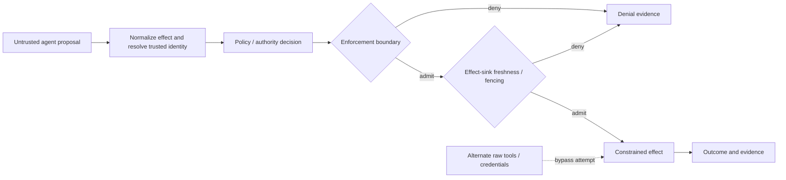

# RFC (discussion draft): Agent Tool-Execution Authorization Conformance

**Status:** PROPOSED — for OpenSSF AI/ML Security Working Group feedback  
**Date:** 2026-11-06  
**Proposer:** Micrantha / Anthesis community  
**Normative status:** None. This is an interoperability proposal, not an accepted Anthesis RFC, OpenSSF standard, SAF-MCP deliverable, or claim of Linux Foundation affiliation.  
**License:** No separate license grant is asserted by this document; publication and reuse terms must be established before importing it into another project.

## Summary

Propose a small, **implementation-independent test suite** for evaluating the security properties of agent-initiated tool execution: authenticated identity, exact-effect authorization, policy freshness, replay safety, revocation at the effect boundary, recovery, and evidence integrity.

A system should be able to run the suite whether it uses Anthesis, a separate MCP gateway, an agent runtime, a capability service, or its own policy engine. Results must specify the tested **enforcement point and residual bypass paths**. A policy evaluator that returns `allow` is not evidence that the effect is mediated.

This RFC solicits working-group feedback on threat coverage, overlap with existing security efforts, common terminology, and a suitable neutral contribution home. It does not ask the working group to adopt Anthesis or fund Micrantha.

## Problem and scope

Tool calls transition from agent-generated proposals to externally observable effects. Authorization may be correct at the decision point but stale when the effect is committed; other pathways may bypass the decision entirely.

**In scope:** controlled tests for single consequential effects, mediated tool dispatch, current authority/policy checks, actor/scope binding, duplicate requests, revocation races, interrupted outcomes, and evidence semantics.

**Out of scope:** general agent reasoning quality, model alignment, arbitrary OS sandboxing, all provider-specific authorization protocols, universal distributed exactly-once semantics, claims of zero bypass without an enumerated effect surface, and certification/compliance labels.

### Trust-boundary model



The diagram is conceptual. Implementations must say whether the effect is transactional, delegated to another service, or asynchronous. **A local database fence does not prove downstream external-provider revocation.**

## Conformance profile proposal

Separate the test **profile** from each implementation's wiring:

- `decision-only`: policy/authority evaluation only. Does not qualify execution enforcement.
- `mediated-dispatch`: controlled runtime/tool registry or gateway; demonstrate denial of direct alternatives within the enumerated surface.
- `owned-effect-sink`: current-authority fencing at a bounded effect sink; demonstrate a defined commit linearization point.
- `external-provider`: downstream authorization and failure behavior; vendor/protocol-specific tests required, not covered by the baseline suite.

Each profile declares its trusted components, authority sources, effect targets, revocation semantics, clock assumptions, tested bypass routes and unsupported guarantees. There is **no aggregate PASS** that silently upgrades one profile into another.

## Proposed scenario catalog

| ID | Scenario | Required observation | Caveat |
| --- | --- | --- | --- |
| AUTH-001 | Valid authenticated actor and exact allowed effect | One allowed bounded operation with bound decision/effect receipt | Not a general production guarantee |
| AUTH-002 | Actor/tenant impersonation or confused deputy | Hard denial; no effect | Actor must originate at trusted boundary |
| AUTH-003 | Capability/action/target or argument substitution | Hard denial; no out-of-scope effect | Canonicalization must be specified |
| AUTH-004 | Previously allowed request after policy revision | Current-policy denial before effect | Policy source and freshness requirement explicit |
| AUTH-005 | Revoked or stale authority epoch | Stale epoch denied at tested sink | Test cannot infer external provider fencing |
| AUTH-006 | Replay and duplicated dispatch | No unintended duplicate logical effect under documented idempotency window | No universal exactly-once claim |
| AUTH-007 | Concurrent revoke and effect commit | Determinate outcome and reproducible ordering at owned sink | Define linearization point; use controlled race |
| AUTH-008 | Crash after dispatch with unknown outcome | `indeterminate` and safe reconciliation; no blind replay | Requires actual recovery evidence |
| AUTH-009 | Raw tool/credential bypass | Blocked within explicitly enumerated runtime surface | A hidden alternate path invalidates the claim |
| AUTH-010 | Receipt substitution or source mismatch | Evidence verification rejects mismatched request, revision or outcome | A receipt does not independently prove actual effect |

**Expected results are specifications for future tests, not observations.** No scenario is marked verified by this RFC.

## Candidate adapter-neutral evidence envelope

This is an **illustrative field set** rather than an interoperable schema or source-code contract:

```json
{
  "profile": "owned-effect-sink",
  "scenario_id": "AUTH-005",
  "implementation_id": "example-gateway",
  "source_revision": "replace-with-real-commit-sha",
  "request_digest": "replace-with-test-request-digest",
  "trusted_actor_ref": "test-principal-A",
  "authority_version": "epoch-7",
  "policy_digest": "replace-with-policy-digest",
  "operation_digest": "replace-with-exact-effect-digest",
  "admission_result": "deny",
  "effect_result": "not_committed",
  "receipt_digest": "replace-with-actual-receipt-digest",
  "verification_status": "not_executed"
}
```

A subsequent schema should distinguish **authorization decision, admission, dispatch, committed effect, denied effect, and unknown effect**; include evidence of identity binding, decision freshness and effect-boundary constraints; and reject fabricated or unverifiable receipts. Cryptographic authenticity, log integrity and trust anchors require a separate threat model.

## Reproducibility and acceptance protocol

A candidate implementation is evaluated only when it supplies:

1. An exact, retrievable source revision and dependency/build identity (and cryptographic artifact digest where applicable).
2. Fixture and policy inputs, trusted identity provenance, and an isolated setup with no real external destructive effect.
3. Exact commands, environment assumptions and recorded outputs for both successful and negative scenarios.
4. Evidence of **state unchanged** on denied paths, not merely an HTTP status or log message.
5. Crash/retry and concurrency evidence where claimed, including order controls and observation windows.
6. A bypass inventory describing all alternative tool, filesystem, process, network and credential paths in the test environment.
7. A results manifest with per-scenario `PASS / FAIL / NOT_RUN / INCONCLUSIVE` and explicit unsupported claims.
8. An independent reviewer report, when invoking independent verification; document reviewed commit and findings.

A test harness must not be accepted merely because expected and actual status strings match. It must inspect the effect sink and make fake receipts/identity claims fail negative controls.

## Interoperability principles

- No mandatory dependency on Anthesis, Keylix, Dubnium, Capability Gateway or Micrantha-controlled services.
- Multiple implementations with the same fixture semantics should be comparable at their **declared profile**, not conflated across enforcement strengths.
- Prefer synthetic identities and disposable resources; do not ingest production credentials, confidential policies or private incident data.
- Mapping to SAF-MCP, MCP security guidance or other catalogs is a **requested collaboration activity**, not a claim of upstream approval.
- Any community conformance logo, scoring, acceptance criteria, license or governance rules require independent project review.

## Proposed first pilot

**Candidate:** `AUTH-002`, `AUTH-003`, `AUTH-005` and `AUTH-009` on one deliberately constrained test tool and a disposable effect sink. Extend to concurrent revocation, replay and crash recovery only after defining reproducible failure controls.

**Pilot artifacts:** threat model, fixture set, runnable harness, source-pinned receipts, bypass inventory, implementation-neutral integration guide, independent review plan.

**Funding:** none requested or committed by this RFC. An LFX Crowdfunding initiative or sponsored engineering arrangement, if pursued, would need separate project eligibility, independent governance and procurement/IP decisions.

## Questions for the working group

1. Is this gap already covered by an existing conformance or security-testing project? Where should tests be contributed rather than duplicated?
2. Which SAF-MCP attack/mitigation categories or other threat models should the suite map to?
3. Should the first iteration standardize **scenario semantics** only, or also the evidence manifest/schema?
4. What is the smallest useful independent implementation target and what tests are essential?
5. What evidence would make an execution-enforcement claim independently reviewable without overstating downstream provider guarantees?
6. Should this work remain a working-group contribution, become a subproject, or be proposed for separate neutral hosting only after external adoption?

## References

- [Anthesis Community](https://github.com/hackelia-micrantha/anthesis-community) — public project/product overview; not a normative source for this proposed suite.
- [Public reference trial](../product/try-anthesis.md) — demonstrates a bounded tool-wrapper integration, with explicit bypass limits.
- [Anthesis Governance Lab](https://github.com/ryjen/anthesis-governance-lab) — separate public evaluator and controlled trial surfaces; not evidence of this proposed conformance suite.
- [OpenSSF AI/ML Security Working Group](https://openssf.org/groups/ai-ml-security/) — intended feedback audience.
- [SAF-MCP](https://github.com/secure-agentic-framework/saf-mcp) — potential threat-catalog mapping to discuss, not an asserted dependency or endorsement.
