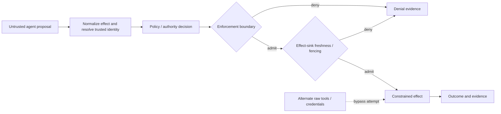

# RFC (discussion draft): Agent Tool-Execution Authorization Conformance

**Status:** PROPOSED — for OpenSSF AI/ML Security Working Group feedback  
**Date:** 2026-11-06  
**Proposer:** Micrantha / Anthesis community  
**Normative status:** None. This is an interoperability proposal, not an accepted Anthesis RFC, OpenSSF standard, SAF-MCP deliverable, or claim of Linux Foundation affiliation.  
**License:** Authored here as a public discussion draft, but the repository has no verified general redistribution license for this RFC. Permission to copy, modify, or contribute this text upstream must be explicitly confirmed by the rights holder and aligned with the destination project's licensing before submission. The proposal itself does not relicense Anthesis implementations or contracts.

## Summary

Propose a small, **implementation-independent test suite** for evaluating the security properties of agent-initiated tool execution: authenticated identity, exact-effect authorization, policy freshness, replay safety, revocation at the effect boundary, recovery, and evidence integrity.

A system should be able to run the suite whether it uses Anthesis, a separate MCP gateway, an agent runtime, a capability service, or its own policy engine. Results must specify the tested **enforcement point and residual bypass paths**. A policy evaluator that returns `allow` is not evidence that the effect is mediated.

This RFC solicits working-group feedback on threat coverage, overlap with existing security efforts, common terminology, and a suitable neutral contribution home. It does not ask the working group to adopt Anthesis or fund Micrantha.

## Problem and scope

Tool calls transition from agent-generated proposals to externally observable effects. Authorization may be correct at the decision point but stale when the effect is committed; other pathways may bypass the decision entirely.

**In scope:** controlled tests for single consequential effects, mediated tool dispatch, current authority/policy checks, actor/scope binding, duplicate requests, revocation races, interrupted outcomes, and evidence semantics.

**Out of scope:** general agent reasoning quality, model alignment, arbitrary OS sandboxing, all provider-specific authorization protocols, universal distributed exactly-once semantics, claims of zero bypass without an enumerated effect surface, and certification/compliance labels.

### Trust-boundary model



The diagram is conceptual. Implementations must say whether the effect is transactional, delegated to another service, or asynchronous. **A local database fence does not prove downstream external-provider revocation.**

## Conformance profile proposal

Separate the test **profile** from each implementation's wiring:

- `decision-only`: policy/authority evaluation only. Does not qualify execution enforcement.
- `mediated-dispatch`: controlled runtime/tool registry or gateway; demonstrate denial of direct alternatives within the enumerated surface.
- `owned-effect-sink`: current-authority fencing at a bounded effect sink; demonstrate a defined commit linearization point.
- `external-provider`: downstream authorization and failure behavior; vendor/protocol-specific tests required, not covered by the baseline suite.

Each profile declares its trusted components, authority sources, effect targets, revocation semantics, clock assumptions, tested bypass routes and unsupported guarantees. Scenarios are applicable only when their required enforcement boundary exists: a decision-only evaluator cannot pass effect-sink tests, and an owned-effect-sink test must not claim external-provider properties. There is **no aggregate PASS** that silently upgrades one profile into another.

### Applicability and qualification

Scenario outcomes are `PASS | FAIL | NOT_RUN | NOT_APPLICABLE | INCONCLUSIVE`. `NOT_APPLICABLE` requires an explicit profile-based rationale, and must never be used to hide a required test. A profile qualifies only if **all required applicable scenarios PASS** at the declared exact source revision and test environment. `FAIL`, `NOT_RUN` and `INCONCLUSIVE` prevent qualification; optional checks cannot compensate. Neither a `decision-only` qualification nor `owned-effect-sink` qualification implies `external-provider` qualification.

| Profile | Initial required case(s) | Constraints |
| --- | --- | --- |
| `decision-only` | Decision fixture evaluation for identity/scope/policy using AUTH-002/003/004 at the decision boundary | Must label effect-commit assertions NOT_APPLICABLE; decision correctness only |
| `mediated-dispatch` | AUTH-002, AUTH-003, AUTH-009 | Enumerate and test agent-visible alternate tool and credential paths |
| `owned-effect-sink` | AUTH-002, AUTH-003, AUTH-005; AUTH-007 before claiming concurrent-revocation safety | Observe actual sink writes and define serialization/linearization point |
| `external-provider` | No baseline qualification defined | Requires a provider-specific extension and its own required suite |

These are **candidate requirements for review**, not a frozen certification scheme. A future profile manifest must pin versioned applicability and prevent a tester from redefining required cases to manufacture a PASS.

## Proposed scenario catalog

| ID | Scenario | Required observation | Caveat |
| --- | --- | --- | --- |
| AUTH-001 | Valid authenticated actor and exact allowed effect | One allowed bounded operation with bound decision/effect receipt | Not a general production guarantee |
| AUTH-002 | Actor/tenant impersonation or confused deputy | Hard denial; no effect | Actor must originate at trusted boundary |
| AUTH-003 | Capability/action/target or argument substitution | Hard denial; no out-of-scope effect | Canonicalization must be specified |
| AUTH-004 | Previously allowed request after policy revision | Current-policy denial before effect | Policy source and freshness requirement explicit |
| AUTH-005 | Revoked or stale authority epoch | Stale epoch denied at tested sink | Test cannot infer external provider fencing |
| AUTH-006 | Replay and duplicated dispatch | No unintended duplicate logical effect under documented idempotency window | No universal exactly-once claim |
| AUTH-007 | Concurrent revoke and effect commit | Determinate outcome and reproducible ordering at owned sink | Define linearization point; use controlled race |
| AUTH-008 | Crash after dispatch with unknown outcome | `indeterminate` and safe reconciliation; no blind replay | Requires actual recovery evidence |
| AUTH-009 | Raw tool/credential bypass | Blocked within explicitly enumerated runtime surface | A hidden alternate path invalidates the claim |
| AUTH-010 | Receipt substitution or source mismatch | Evidence verification rejects mismatched request, revision or outcome | A receipt does not independently prove actual effect |

**Expected results are specifications for future tests, not observations.** No scenario is marked verified by this RFC.

## Execution, observation and evidence state semantics

Three **orthogonal dimensions** must be reported separately:

| Dimension | Candidate states | What it means |
| --- | --- | --- |
| Decision / admission | `allow`, `deny`, `approval_required`, `escalate`, `indeterminate` | A policy decision and whether the enforcement boundary admitted the exact operation; these are distinct recorded fields |
| Effect lifecycle | `not_dispatched`, `dispatched`, `committed`, `failed`, `unknown` | Observed effect status; `not_dispatched` is not automatically evidence that a raw bypass did not occur |
| Evidence verification | `valid`, `invalid`, `insufficient`, `not_evaluated` | Integrity, provenance and semantic checks for a particular claim; `valid` is not an authorization outcome |

**Safety invariant:** `decision=deny` or `admission=deny` may coexist with `effect=committed` if a bypass occurred; this is a **FAIL**, not an invalid record to discard. `effect=unknown` is not `not_committed`. A signed receipt describing a successful action does not alone establish the effect happened. Evidence verification must state the *specific claim* it validates and the observations/trust assumptions backing it.

**Candidate transition constraints:** `not_dispatched -> dispatched -> committed/failed/unknown`; `unknown` may become `committed` or `failed` only through documented reconciliation evidence. Transitions are observational, not guarantees that asynchronous systems will reveal every effect. In particular, absence of a recorded dispatch is insufficient proof of no effect if other routes exist. A denied admission with a committed effect constitutes a bypass finding.

For concurrent revocation (AUTH-007), publish the effect sink's **linearization point**, the revocation operation's linearization point, and controlled interleavings; permit-before-revoke can commit and revoke-before-effect must deny under the declared consistency model. Provider-delayed asynchronous effects may continue after a local revocation and remain OUT OF SCOPE until independently fenced at that provider.

## Candidate adapter-neutral evidence envelope

This is an **illustrative field set** rather than an interoperable schema or source-code contract:

```json
{
  "profile": "owned-effect-sink",
  "scenario_id": "AUTH-005",
  "implementation_id": "example-gateway",
  "source_revision": "replace-with-real-commit-sha",
  "request_digest": "replace-with-test-request-digest",
  "trusted_actor_ref": "test-principal-A",
  "authority_version": "epoch-7",
  "policy_digest": "replace-with-policy-digest",
  "operation_digest": "replace-with-exact-effect-digest",
  "decision_result": "deny",
  "admission_result": "deny",
  "effect_state": "not_dispatched",
  "effect_observation": "example-sink-state-unchanged-observation",
  "receipt_digest": "replace-with-actual-receipt-digest",
  "evidence_verification": "not_evaluated",
  "scenario_result": "NOT_RUN"
}
```

A subsequent schema should distinguish **authorization decision, admission, dispatch, committed effect, denied effect, and unknown effect**; include evidence of identity binding, decision freshness and effect-boundary constraints; and reject fabricated or unverifiable receipts. Cryptographic authenticity, log integrity and trust anchors require a separate threat model.

## Optional provenance integrations: Sigstore and gittuf

**Status:** existing Anthesis-specific integration/design surfaces; **optional** for independent conformance implementations. This RFC does not assert those integrations have passed conformance or are deployed in production.

Anthesis already contains a `SigstoreVerifier` using `cosign verify-blob` for plugin-distribution verification in the private implementation, and RFC-0044 describes **gittuf as its Git-native repository policy and verification substrate**. These are existing components/design commitments, **not new proposed integrations**. The conformance proposal instead asks whether their provenance properties should be tested through portable optional adapters. Do not confuse implemented verification code, living RFC design and verified runtime rollout.

This proposal intentionally separates (1) authenticating the **origin and integrity** of evidence from (2) authorizing a **current effect** and (3) proving that the effect was actually constrained or committed.

- **Sigstore / Cosign:** existing Anthesis plugin-verification usage, plus a candidate extension for signing digest-bound test manifests, release artifacts or in-toto attestations. Verification must pin the expected signer identity and OIDC issuer (or an explicitly configured trusted key), check the signed subject digest, and validate the configured Sigstore trust root / transparency evidence. A valid signature or log inclusion is provenance evidence, **not** proof that the attested claims are true.
- **gittuf:** an existing Anthesis RFC-0044 architectural integration for signed repository policy, approved reference transitions and independently verifiable Git history; proposed conformance checks for those properties would be optional. It can strengthen source-revision provenance for a test input, but does **not** authorize runtime tool effects or automatically provide freshness of the current repository state to an offline verifier.
- **Baseline compatibility:** implementations **must not require** Sigstore, gittuf, GitHub, public network access, a particular CI service, or Micrantha infrastructure to produce baseline conformance evidence. These mechanisms are optional provenance adapters. An implementation can demonstrate equivalent properties through a separately documented trust root and verifier.

### Candidate provenance verification cases

| ID | Question | Expected verifier behavior | Scope |
| --- | --- | --- | --- |
| PROV-001 | Is an evidence bundle signed by an expected identity over the exact digest? | Reject tampered payloads, unexpected identities or issuers and invalid signatures | Optional Sigstore adapter |
| PROV-002 | Does the claimed source revision match the trusted Git history/policy record? | Reject untrusted reference updates and a mismatched source/release identity | Optional gittuf adapter |
| PROV-003 | Is the artifact's signed provenance being mistaken for runtime authority? | Verifier may accept provenance but **must not** upgrade a denied, stale or unobserved effect into authorization success | Cross-profile negative control |

These scenarios are **PROPOSED / NOT_RUN**, not part of the initial AUTH-001–010 pilot or a claim that integrations already exist.

### Trust-root and offline-verifier constraints

- State how the verifier initially obtains and authenticates signer policies, keys, OIDC identity constraints, gittuf roots and expected reference-log tips. Trust-on-first-use must be identified as such.
- A signature over a false claim remains a signed false claim. Validate **subject, predicate semantics, input/output binding and effect-sink observations** independently.
- Transparency inclusion is not the same as independent audit of the claims or guarantee of up-to-date revocation/policy state. A signed reference-state log still requires a freshness source or a declared bounded-staleness assumption.
- Avoid posting secret-bearing request details or sensitive evidence in public attestations or transparency logs; publish only safe digests and reviewed metadata when appropriate.
- Define how a verifier reports `authentic-but-untrusted`, `not-fresh`, `unverifiable`, `verified-provenance` separately from `effect-authorized` and `effect-observed`.

**Design questions:** Should source-repository provenance be a separate `provenance` profile rather than part of execution conformance? Which minimum identity / expected-policy checks are mandatory when an optional Sigstore or gittuf adapter is claimed?

For PROV-002, separately establish (a) authenticated gittuf trust-root and policy history, (b) whether a particular protected ref update satisfied that policy, (c) the freshness of the reference state relative to an independently observed remote state, and (d) linkage between the evaluated artifact and that verified source. A historical valid gittuf log can be stale; a correctly signed artifact may originate from an unapproved ref update. Report these outcomes independently.

## Reproducibility and acceptance protocol

A candidate implementation is evaluated only when it supplies:

1. An exact, retrievable source revision and dependency/build identity (and cryptographic artifact digest where applicable).
2. Fixture and policy inputs, trusted identity provenance, and an isolated setup with no real external destructive effect.
3. Exact commands, environment assumptions and recorded outputs for both successful and negative scenarios.
4. Evidence of **state unchanged** on denied paths, not merely an HTTP status or log message.
5. Crash/retry and concurrency evidence where claimed, including order controls and observation windows.
6. A bypass inventory describing all alternative tool, filesystem, process, network and credential paths in the test environment.
7. A results manifest with per-scenario `PASS / FAIL / NOT_RUN / NOT_APPLICABLE / INCONCLUSIVE`, the tested profile version, reasons for inapplicability, and explicit unsupported claims.
8. An independent reviewer report, when invoking independent verification; document reviewed commit and findings.

A test harness must not be accepted merely because expected and actual status strings match. It must inspect the effect sink and make fake receipts/identity claims fail negative controls.

## Interoperability principles

- No mandatory dependency on Anthesis, Keylix, Dubnium, Capability Gateway or Micrantha-controlled services.
- Multiple implementations with the same fixture semantics should be comparable at their **declared profile**, not conflated across enforcement strengths.
- Prefer synthetic identities and disposable resources; do not ingest production credentials, confidential policies or private incident data.
- Mapping to SAF-MCP, MCP security guidance or other catalogs is a **requested collaboration activity**, not a claim of upstream approval.
- Any community conformance logo, scoring, acceptance criteria, license or governance rules require independent project review.

## Relationship to existing community work

| Project / initiative | Complementary scope | Proposed interface, not an adopted integration |
| --- | --- | --- |
| [SAFE-MCP](https://github.com/SAFE-MCP/safe-mcp) / OpenSSF AI/ML Security | Agent/MCP threat identification and mitigations | Map selected attack classes to measurable authorization/enforcement scenarios |
| [SLSA](https://slsa.dev/) | Source/build provenance and assurance levels | Record provenance for conformance harness and tested binaries, not authority to execute |
| [GUAC](https://guac.sh/) | Graph of software supply-chain relationships | Optional export/query of evidence lineage and artifact relationships |
| [Gemara](https://openssf.org/projects/) | Structured governance/compliance modeling | Explore control-to-test mappings, without claiming audit certification |
| [OpenSSF OSPS Baseline](https://baseline.openssf.org/) and [Scorecard](https://securityscorecards.dev/) | Project security hygiene and maturity | Assess the conformance project's own delivery/security posture |
| [OpenSSF Model Signing](https://openssf.org/projects/) | ML model signature verification | Candidate provenance mapping for model-input supply chains; not necessary for v1 authorization |
| [OSS-CRS](https://openssf.org/projects/) | AI-driven vulnerability discovery/repair orchestration | Candidate constrained agent-effect test environment, not a dependency |
| [AAIF MCP](https://modelcontextprotocol.io/) and [agentgateway](https://github.com/agentgateway/agentgateway) | Agent tool protocol and gateway mediation | Potential independent adapters for tool identity, mediation and denial tests |
| [AAIF Agent Skills](https://github.com/agentskills/agentskills) | Portable skill instructions, scripts and resources | Test untrusted skill content, script execution authority and permission confusion; optional `skill provenance` fixture, not execution permission |
| [AAIF Open Responses](https://www.openresponses.org/specification) | Provider-neutral response, stream and tool-call schema | Test translation of model-proposed calls to exact admission requests; distinguish developer-controlled from provider-hosted tools, and handle partial/duplicate streaming events |
| [AAIF OpenEnv](https://github.com/openenv/OpenEnv) | Reproducible RL/agent environments with reset/step/state interfaces and MCP | Candidate reproducible negative-test environment for tool misuse, revocation and adversarial trajectories; not a security enclosure guarantee |
| [AAIF OpenSandbox](https://www.linuxfoundation.org/press/agentic-ai-foundation-announces-four-new-projects-agent-skills-open-responses-openenv-and-opensandbox) | Agent execution runtime isolation with Docker/Kubernetes adapters | Candidate isolated effect-sink test substrate; isolation does not itself authorize a requested effect |
| [CNCF SPIFFE/SPIRE](https://www.cncf.io/projects/spiffe/) | Workload identity and attestation | Candidate trusted actor identity input; authorization requires a distinct policy decision |
| [CNCF Open Policy Agent](https://www.cncf.io/projects/open-policy-agent-opa/) | Independent policy decision evaluation | Useful implementation-neutral comparison for `decision-only` profiles |
| [CNCF in-toto](https://www.cncf.io/projects/) | Attested software supply-chain steps | Candidate schema/attestation alignment for evidence provenance; does not prove live effect admission |
| [CNCF OpenTelemetry](https://opentelemetry.io/) | Runtime tracing and correlation | Optional diagnostics for decision/dispatch/effect linkage, not a tamper-proof evidence ledger |

**AAIF-specific security boundaries:** Agent Skills' experimental `allowed-tools` metadata is not a trust-rooted authorization grant. Open Responses `tool_choice` and `allowed_tools` controls are provider/runtime tool-selection and admission surfaces, not proof of authority at an external effect sink; provider-hosted tools may not traverse a developer-controlled Anthesis gateway. OpenEnv `reset()` must also reset or explicitly version persistent authorization and effect-sink state for repeatable tests. OpenSandbox's process isolation still requires credential, filesystem, network and provider bypass controls at their real boundaries.

The proposal should **reuse** existing Governance Lab public vectors and harness infrastructure where semantically equivalent; maintain a mapping of `AUTH-*` scenarios to current public fixtures. New effect-sink tests should be separate where existing deterministic evaluator fixtures lack an enforced effect boundary. None of the listed projects is asserted as an official sponsor, partner or approving body.

## Proposed first pilot

**Candidate:** `AUTH-002`, `AUTH-003` and `AUTH-009` for a constrained mediated-dispatch profile, plus `AUTH-005` for an explicitly separate owned-effect-sink profile. The pilot must report each profile independently; one passing profile does not qualify the other. Extend to concurrent revocation, replay and crash recovery only after defining reproducible failure controls.

**Pilot artifacts:** threat model, Governance Lab fixture reuse/gap matrix, runnable harness, source-pinned receipts, bypass inventory, implementation-neutral integration guide, independent review plan.

**Funding:** none requested or committed by this RFC. An LFX Crowdfunding initiative or sponsored engineering arrangement, if pursued, would need separate project eligibility, independent governance and procurement/IP decisions.

## Questions for the working group

1. Is this gap already covered by an existing conformance or security-testing project? Where should tests be contributed rather than duplicated?
2. Which SAF-MCP attack/mitigation categories or other threat models should the suite map to?
3. Should the first iteration standardize **scenario semantics** only, or also the evidence manifest/schema?
4. What is the smallest useful independent implementation target and what tests are essential?
5. What evidence would make an execution-enforcement claim independently reviewable without overstating downstream provider guarantees?
6. Should this work remain a working-group contribution, become a subproject, or be proposed for separate neutral hosting only after external adoption?
7. Would optional Sigstore attestations or gittuf repository-policy verification add value as separate provenance adapters, without coupling execution conformance to those toolchains?

## References

- [Anthesis Community](https://github.com/hackelia-micrantha/anthesis-community) — public project/product overview; not a normative source for this proposed suite.
- [Public reference trial](../product/try-anthesis.md) — demonstrates a bounded tool-wrapper integration, with explicit bypass limits.
- [Anthesis Governance Lab](https://github.com/ryjen/anthesis-governance-lab) — separate public evaluator and controlled trial surfaces; not evidence of this proposed conformance suite.
- [OpenSSF AI/ML Security Working Group](https://openssf.org/groups/ai-ml-security/) — intended feedback audience.
- [SAF-MCP](https://github.com/secure-agentic-framework/saf-mcp) — potential threat-catalog mapping to discuss, not an asserted dependency or endorsement.

- [Sigstore signing and verification](https://docs.sigstore.dev/about/overview/) — candidate provenance mechanism; not an authorization engine.
- [gittuf design](https://github.com/gittuf/gittuf/blob/main/docs/design-document.md) — candidate trusted Git policy and reference-state verification; not an effect-sink fence.
